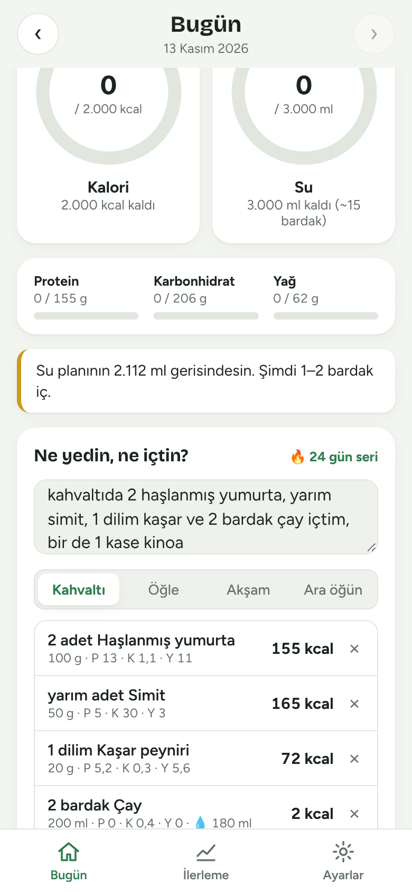
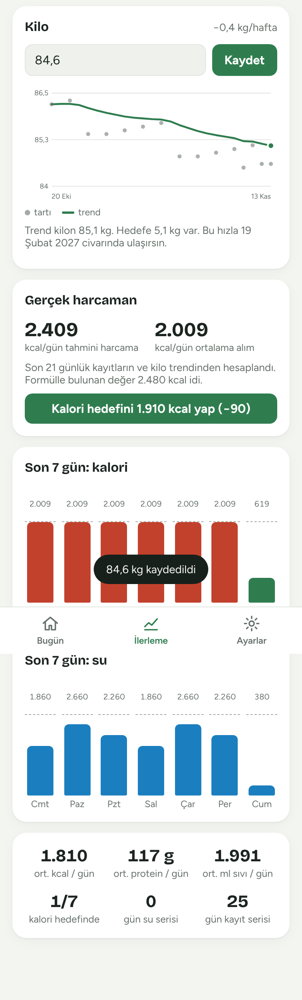
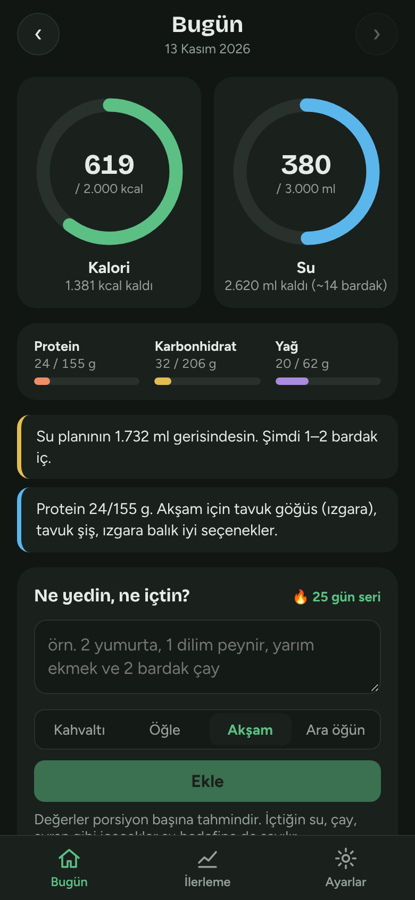

# Kal – Kalori, Su ve Kettlebell Takibi

**Canlı adres:** https://yusuf-karakaya.github.io/kal-app/ (telefonda açıp "Ana ekrana ekle")

Günlük kalori, su ve kettlebell antrenmanını takip eden, gün içinde hatırlatma bildirimleri gönderen uygulama.
İki sürümü var, ikisi de aynı veri biçimini kullanır. Sunucu ya da hesap gerekmez; veriler cihazında tutulur.

| Sürüm | Klasör | Bildirimler |
| --- | --- | --- |
| **Mobil uygulama** (React Native / Expo) | `mobile/` | Telefona planlanır, uygulama **kapalıyken de** gelir |
| **Web uygulaması** (PWA) | `app/` | Uygulama açıkken veya arka plandayken gelir |

<p><em>Ekran görüntüleri örnek verilerle alınmıştır.</em></p>
<p>
  
  
  
</p>

## Özellikler

### Ne yediğini yaz, gerisini o hesaplasın
Sektördeki en hızlı kayıt yöntemi (Amy, PlateLens vb.): yemeği düz cümleyle yazarsın, uygulama
kalori, protein, karbonhidrat ve yağı hesaplar.

> *"kahvaltıda 2 haşlanmış yumurta, yarım simit, 1 dilim kaşar ve 2 bardak çay içtim"*
> → 4 kalem, 394 kcal, 23 g protein; öğün otomatik "Kahvaltı", çay su hedefine 180 ml olarak sayılır.

- **250+ yemek ve içecek**: kahvaltılıklar, çorbalar, ev yemekleri, kebaplar, fast food, tatlılar,
  meyveler, kuruyemişler, kahveler. Değerler 100 g başına; TürKomp ve USDA temel alınarak yuvarlanmış tahminlerdir.
- **Türkçe anlama**: yazıyla sayılar (*iki, yarım, bir buçuk*), ölçüler (*su bardağı, yemek kaşığı, dilim,
  kase, 150 gr, 330 ml*), ekli kelimeler (*ekmeği, çayı*), Türkçe karaktersiz yazım (*corba, yogurt*),
  sonda yazılan miktar (*pizza 2 dilim*), niteleyiciler (*peynirli tost* → tost).
- **Öğrenir**: tanımadığı yemeğin kalorisini bir kez yazarsın, bir dahaki sefere kendisi hesaplar.
- **Hızlı tekrar**: son yediklerin tek dokunuşla eklenir; dünkü öğünü "↻ Dün" ile tekrarlarsın.
- **Düzenleme**: kayda dokunup porsiyonu ½×, 1,5×, 2× yaparsın ya da başka öğüne taşırsın.

### Makrolar ve hedefler
- Mifflin-St Jeor ile günlük harcama; amaca göre kalori hedefi (hızlı/yavaş kilo verme, koruma, alma).
- Protein kilo başına 1,6–1,8 g, yağ kalorinin %28'i, kalanı karbonhidrat. Hepsi elle de değiştirilebilir.
- Su hedefi kilo başına 35 ml + aktivite payı.

### Su ve içecekler
- +200 / +330 / +500 ml düğmeleri ve çay, kahve, ayran, süt, meyve suyu, kola gibi içecekler.
- Her içecek sıvı dengesine **hidrasyon oranıyla** sayılır (su %100, çay %90, kahve %80, alkol %0);
  kalorisi varsa kaloriye de eklenir.

### İlerleme
- **Kilo trendi**: günlük tartılar üstel hareketli ortalamayla yumuşatılır (su/tuz dalgalanması gizlenir),
  haftalık değişim hızı ve hedef kiloya tahmini varış tarihi gösterilir.
- **Gerçek harcama (uyarlanır hedef)**: MacroFactor'daki yöntem. Son 3 haftanın kayıtları ve kilo trendinden
  gerçek günlük harcaman hesaplanır, kalori hedefini tek dokunuşla buna göre günceller.
- 7 günlük kalori ve su grafikleri, ortalamalar, **seriler** (su hedefi ve kayıt).

### Öneriler ve hatırlatmalar
- Günlük öneriler: su planının gerisinde misin, protein eksik mi (kalan kaloriye uyan yüksek proteinli
  yemekler önerilir), hedef aşıldı mı, kilo çok mu hızlı gidiyor.
- Su hatırlatıcısı son içtiğin andan itibaren sayar ve hedefe ulaşınca susar; öğün hatırlatıcısı
  yalnızca o öğün girilmemişse gelir; gün sonu özeti ve tartılma hatırlatıcısı.
- Su bildirimindeki **"+200 ml içtim"** butonu uygulamayı açmadan su ekler.

### Kettlebell Haftası (Antrenman sekmesi)
- Tek kettlebell ile 7 günlük program: alt vücut, üst vücut, aktif dinlenme, tüm vücut güç,
  ön kol & core, metcon, tam dinlenme. Kettlebell ağırlığı ayarlardan değiştirilebilir.
- Her set için dokun-işaretle; set işaretlenince o hareketin dinlenme sayacı başlar (sesli/titreşimli).
- Form ipuçları ve her hareket için YouTube Shorts video araması.
- Haftalık ilerleme, geçmiş haftalara gezinme, yakılan kalori tahmini (MET tabanlı).
- **Kal ile bağlantılı:** antrenman yapılan gün su hedefi 500 ml artar; antrenman ve protein önerileri gelir.

### Gizlilik ve parola kilidi
- **Kod herkese açık, verilerin değil.** Yediklerin, kilon, antrenmanların ve profilin yalnızca kendi
  cihazında (tarayıcının yerel depolaması / telefonun uygulama alanı) tutulur; hiçbir sunucuya,
  GitHub'a ya da başka bir yere gönderilmez. Uygulamada analiz, reklam ya da izleme kodu yoktur.
- **Parola kilidi (web):** Ayarlar → Parola kilidi ile açılır. Cihazdaki tüm kayıtlar ve aldığın yedekler
  AES-256-GCM ile şifrelenir; anahtar paroladan PBKDF2-SHA256 (300.000 tur) ile türetilir. Parola hiçbir
  yere kaydedilmez, uygulama her açılışta sorar. Parolayı unutursan veriler açılamaz.
- Mobil uygulamada veriler işletim sisteminin uygulamaya özel korumalı alanında durur.

### Diğer
- Hesap ve sunucu yok. Web ve mobil arasında yedek metniyle taşınır.
- Çevrimdışı çalışır, açık/koyu tema.

## Mobil uygulama (Expo)

Bildirimler telefonun kendi zamanlayıcısına önceden planlanır (bugün ve yarın için). Her su/yemek
kaydında ve uygulama her açıldığında yeniden hesaplanır. Böylece uygulama kapalıyken de:

- su hatırlatması, son içtiğin sudan itibaren seçtiğin aralıkla gelir, hedefe ulaşınca o gün durur;
- öğün hatırlatması, o öğünü henüz girmediysen gelir;
- gün sonu özeti, o ana kadarki toplamlarla gelir.

Su bildirimindeki **“+200 ml içtim” / “+500 ml içtim”** butonları suyu doğrudan ekler.

### Telefonda denemek (en hızlısı: Expo Go)

1. Telefona **Expo Go** uygulamasını kur (App Store / Google Play).
2. Bilgisayarda:
   ```bash
   cd mobile
   npm install
   npx expo start
   ```
3. Ekrandaki QR kodu telefonla okut (Android: Expo Go içinden, iPhone: Kamera ile).
4. Ayarlar sekmesinden hedeflerini gir ve **Bildirimlere izin ver**.

### Kalıcı kurulum (APK / App Store)

Expo Go'ya bağlı kalmadan telefona kurmak için EAS Build kullan (ücretsiz Expo hesabı gerekir):

```bash
cd mobile
npx eas-cli@latest login
npx eas-cli@latest build:configure
npx eas-cli@latest build --platform android --profile preview   # indirilebilir APK verir
```

iPhone'a kurulum için Apple Developer hesabı gerekir (`--platform ios`).

Bilgisayarda tarayıcıda önizlemek için: `npx expo start --web` (bildirimler web'de çalışmaz).

### Kod yapısı

```
mobile/
  src/core/                  web ve mobilin ORTAK çekirdeği (TypeScript, platformdan bağımsız)
    foods.ts                 yemek/içecek veritabanı
    parse.ts                 Türkçe doğal dil ayrıştırıcı
    model.ts                 veri modeli, hedef ve makro hesapları, kayıt işlemleri
    insights.ts              kilo trendi, harcama tahmini, seriler, öneriler
    workout.ts               Kettlebell Haftası programı ve antrenman takibi
    core.test.ts             testler: npm run test:core
  App.tsx                    sekmeler, veri akışı, bildirim butonlarının işlenmesi
  src/data.ts                AsyncStorage + çekirdeğin dışa aktarımı
  src/notifications.ts       bildirim izinleri, kanal/buton tanımları, planlama
  src/ui.tsx                 tema (açık/koyu) ve ortak bileşenler
  src/screens/               Bugün, Antrenman, İlerleme, Ayarlar ekranları
app/
  core.js                    çekirdeğin derlenmiş hali (elle düzenlenmez)
  index.html, app.js, style.css, sw.js
```

Çekirdekte bir değişiklik yaptıktan sonra `cd mobile && npm run test:core && npm run build:web`
çalıştırarak testleri koştur ve web sürümünü güncelle.

## Web uygulaması (PWA)

Özellikler mobil sürümle aynıdır ve aynı çekirdeği kullanır. Çevrimdışı çalışır.

```bash
cd app
python3 -m http.server 8080   # http://localhost:8080
```

Telefonda kullanmak için `app/` klasörünü HTTPS veren bir statik barındırmaya (Netlify, Vercel,
herkese açık bir repoda GitHub Pages) yükle, adresi aç ve **“Ana ekrana ekle”** de.
iPhone'da bildirimler yalnızca ana ekrana eklenmiş uygulamada çalışır (iOS 16.4+).

Web sürümünde bildirimler uygulama açıkken ya da arka planda çalışırken gelir. Bildirim izni yoksa
hatırlatmalar sayfanın üstünde kart olarak çıkar.

`python3 tools/build_single.py dist/kal.html` komutu, uygulamayı service worker gerektirmeyen tek
bir HTML dosyasına dönüştürür (claude.ai Artifact sayfası olarak yayınlamak için kullanıldı).

## Yedeği taşımak

Web sürümünde **Ayarlar → Yedeği kopyala**, mobil sürümde **Ayarlar → Yedeği paylaş** ile alınan
metin, diğer sürümde **Yedeği içe aktar** alanına yapıştırılarak veriler taşınabilir.

## Bu repo hakkında

Bu repo GitHub Pages ile yayınlanır:

| Adres | İçerik |
| --- | --- |
| [`/kal-app/`](https://yusuf-karakaya.github.io/kal-app/) | Uygulamaya yönlendirir |
| [`/kal-app/app/`](https://yusuf-karakaya.github.io/kal-app/app/) | Kal web uygulaması (PWA) |
| [`/kal-app/plan/`](https://yusuf-karakaya.github.io/kal-app/plan/) | Önceki şifreli plan sayfası (token ile açılır, içeriği şifreli) |
